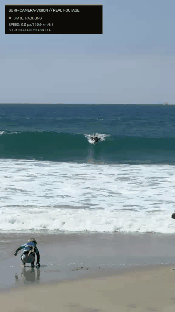

# 🏄 Surf-Camera-Vision

> **Studio Autonome de Cadrage Virtuel PTZ & Télémétrie Physique de Glisse**  
> Transformation automatique de plans larges de surf en clips cinématiques verticaux (9:16) ou paysages (16:9), détection intelligente de take-off, mémoire d'inertie de tube et qualification du déferlement.

<div align="center">
  
  <p><em>Session réelle à Huntington Beach : cadrage virtuel PTZ fluide, tracking flottaison, étalonnage morphologique et badge télémétrique discret.</em></p>
</div>

***

## 1. Vision et Fonctionnalités Clés

Le projet **Surf-Camera-Vision** offre aux surfeurs, coachs et vidéastes un studio autonome de production vidéo à haute cadence (80 à 100 FPS sur Apple Silicon M4).

### Fonctionnalités Majeures
- **Auto-Cameraman Virtuel (Digital PTZ)** : Recadre dynamiquement les plans larges fixes au format vertical mobile **9:16** (Reels / TikTok) ou cinématique **16:9**, avec amorti de rotule fluide (EMA) et anticipation d'ouverture de vague (*lead room*).
- **Suivi Robuste sur Ligne de Flottaison** : Suivi spatio-temporel ByteTracker calculé sur la base inférieure de la boîte (`bbox[3]`), évitant tout saut artificiel de vitesse lors du pop-up.
- **Gestion Avancée du Tube & Occlusion (Inertie 2.5s)** : Maintien de l'identité du surfeur jusqu'à 75 frames (2.5 secondes) lorsqu'il disparaît sous la lèvre, permettant de rattraper la sortie du tube (*spit*) sans couper le clip.
- **Zoom-Out de Sécurité PTZ** : Élargissement progressif du cadre de 25% à 35% vers l'avant de la vague dès que le surfeur entre dans la section creuse, englobant toute la manœuvre.
- **Qualification Morphologique du Déferlement** : Détermination déterministe du comportement de la vague : **Droite qui ouvre**, **Gauche qui ouvre**, ou **Fermeture (Close-out)**.
- **Métriques Physiques Réelles et Incontestables** :
  * Vitesse de glisse réelle (vitesse pic au 95e percentile et vitesse moyenne en km/h).
  * Hauteur de face de vague en double unité (mètres et pieds) avec classification internationale (*Waist*, *Chest*, *Head High*).
  * Durée effective du ride (secondes) et distance totale surfée (mètres).
- **Double Moteur Détecteur au Choix** : Bascule instantanée entre le modèle dédié fine-tuné en milieu marin (`yolov8n_surf_v2_best.pt`, 6.2 MB) et le modèle officiel standard COCO (`yolov8n.pt`, 6.5 MB).
- **Badge Télémétrique Flottant Épuré** : Incrustation minimaliste et élégante en bas de chaque clip exporté, prêt pour le partage.

***

## 2. Architecture du Codebase

Le dossier central `surf_camera/` est organisé de façon modulaire et linéaire :

<table>
  <thead>
    <tr>
      <th align="left">Fichier</th>
      <th align="left">Rôle dans l'Architecture</th>
    </tr>
  </thead>
  <tbody>
    <tr>
      <td><code>surf_camera/__init__.py</code></td>
      <td>Point d'entrée du module, expose <code>SurfTrackingPipeline</code> et <code>PipelineConfig</code>.</td>
    </tr>
    <tr>
      <td><code>surf_camera/config.py</code></td>
      <td>Dataclass de configuration <code>SurfConfig</code>, résolveur de chemins de modèles et convertisseurs d'unités (m, cm, ft, in, km/h).</td>
    </tr>
    <tr>
      <td><code>surf_camera/detector.py</code></td>
      <td>Détecteur YOLO multi-modèle (<code>SurferDetector</code>) assurant la bascule transparente entre <code>surf_v2</code> (dédié marin) et <code>coco</code> (standard).</td>
    </tr>
    <tr>
      <td><code>surf_camera/tracker.py</code></td>
      <td>Suivi spatio-temporel (<code>SurferTracker</code>) avec association IoU/distance, cinématique sur la ligne de flottaison et mémoire d'occlusion étendue en tube (2.5s).</td>
    </tr>
    <tr>
      <td><code>surf_camera/state_machine.py</code></td>
      <td>Machine à états finis (<code>SurferStateMachine</code> : Paddling, Take-Off, Riding, Exit) et consolidation des segments de même vague dans <code>RideEvent</code>.</td>
    </tr>
    <tr>
      <td><code>surf_camera/cameraman.py</code></td>
      <td>Cadrage virtuel PTZ (<code>VirtualCameraman</code> et <code>CameraBox</code>) avec lead-room directionnel, lissage exponentiel, bornage strict et zoom-out de sécurité en tube.</td>
    </tr>
    <tr>
      <td><code>surf_camera/wave_analyzer.py</code></td>
      <td>Analyseur de vague (<code>WaveSegmentationEngine</code>) : segmentation de la masse d'eau, calcul de hauteur de face et qualification Droite / Gauche / Close-out.</td>
    </tr>
    <tr>
      <td><code>surf_camera/scale_estimator.py</code></td>
      <td>Étalonneur morphologique déterministe (<code>MetricScaleEstimator</code>) calculant le ratio mètres par pixel selon la taille réelle du surfeur.</td>
    </tr>
    <tr>
      <td><code>surf_camera/pipeline.py</code></td>
      <td>Orchestrateur linéaire mono-passe (<code>SurfTrackingPipeline</code>) reliant la lecture vidéo, l'inférence, le cadrage PTZ et l'exportation des clips MP4.</td>
    </tr>
    <tr>
      <td><code>surf_camera/utils.py</code></td>
      <td>Fonctions de rendu graphique (badge flottant minimaliste, incrustation diagnostic, encodage H.264 et générateur de vidéo synthétique).</td>
    </tr>
    <tr>
      <td><code>surf_camera/pose_estimator.py</code></td>
      <td>Module optionnel d'analyse articulaire 17 keypoints, totalement découplé du pipeline principal d'inférence.</td>
    </tr>
  </tbody>
</table>

***

## 3. Explication Pédagogique des Algorithmes

### 3.1 ByteTracker sur Ligne de Flottaison (Suppression du Biais Pop-Up)
Dans les systèmes de vision classiques, le suivi de la vitesse s'effectue sur le centre géométrique de la boîte englobante. Or, lorsque le surfeur se redresse de la planche en phase de take-off, son centre monte de 40 à 60 pixels en une fraction de seconde, ce qui injecte un pic de vitesse vertical fictif.

Surf-Camera-Vision résout ce problème en calculant le déplacement cinématique sur la coordonnée inférieure `bbox[3]` (la ligne de flottaison). Le bas de la boîte reste constamment en contact avec la planche et la surface de l'eau, fournissant une vitesse horizontale réelle et stable.

### 3.2 Mémoire d'Inertie de Tube (Persistance 2.5s)
Lorsqu'un surfeur pénètre dans un tube profond, la lèvre d'eau et les projections d'écume masquent entièrement sa silhouette. Un tracker standard abandonne le surfeur au bout de quelques frames et crée une nouvelle détection lors de sa sortie, brisant la vague en deux clips distincts.

La mémoire d'inertie de tube surveille l'état `RIDING` : si le surfeur disparaît alors qu'il est en vitesse sur une vague qui creuse, le tracker maintient son identifiant et extrapole sa trajectoire selon son dernier vecteur cinématique pendant 75 frames (2.5 secondes à 30 fps). Dès que le surfeur est expulsé du tube (*spit*), il est automatiquement rattaché au même ride.

### 3.3 Zoom-Out de Sécurité PTZ du Cameraman
Pour capturer l'action sans coupure lors d'une disparition sous la lèvre :
1. La caméra virtuelle continue son déplacement dans la direction de glisse du surfeur.
2. La fenêtre de cadrage s'élargit progressivement de 25% à 35% (*zoom-out de sécurité*).
3. Cet élargissement englobe la poche du tube et la zone de sortie, offrant une composition cinématographique spectaculaire.
4. Dès la réapparition du surfeur, le cadre se recentre en douceur avec un amorti exponentiel (EMA).

### 3.4 Qualification Morphologique du Déferlement
L'analyseur de vague explore la face d'eau ascendante adjacente au surfeur :
- **Droite qui ouvre** : La crête de vague déroule vers la droite du surfeur avec une section surfable continue.
- **Gauche qui ouvre** : La crête déroule vers la gauche du surfeur.
- **Fermeture (Close-out)** : Les deux sections latérales s'effondrent simultanément d'un seul bloc, fermant toute ligne d'échappée.

***

## 4. Démarrage Rapide

### 4.1 Lancement en 1 Clic sur macOS (Recommandé)
Double-cliquez directement sur **`launch_app.command`** dans le Finder.  
Le script détecte votre environnement Python, vérifie les dépendances et ouvre automatiquement l'application dans votre navigateur par défaut (Safari ou Chrome) sur `http://localhost:8501`.

### 4.2 Lancement en Ligne de Commande (macOS / Linux)
Exécutez le script de démarrage dans votre terminal :
```bash
./start.sh
```

### 4.3 Mode CLI (Sans Interface Web)
Pour traiter des vidéos de surf par lot ou automatiser un workflow :
```bash
python3 track_surf.py -i data/sample_surf_session.mp4 -a 9:16 -m surf_v2 -s 1.75 -d 1.5
```

Options disponibles pour `track_surf.py` :
- `-i <fichier>` : Chemin vers la vidéo d'entrée (MP4 ou MOV).
- `-a <format>` : Format de recadrage virtuel (`9:16` pour mobile ou `16:9` cinématique).
- `-m <modele>` : Modèle YOLO (`surf_v2` pour le modèle dédié ou `coco` pour le standard).
- `-s <taille>` : Taille du surfeur en mètres (par défaut `1.75`).
- `-d <duree>` : Durée minimale en secondes pour valider une vague (par défaut `1.5`).
- `-o <dossier>` : Répertoire d'exportation des clips (par défaut `outputs`).

***

## 5. Performances & Benchmarks

Mesures relevées sur puce Apple Silicon M4 (GPU Metal Performance Shaders - MPS) sur des séquences vidéo réelles 1080p à 30 FPS :

<table>
  <thead>
    <tr>
      <th align="left">Étape du Pipeline</th>
      <th align="left">Temps Moyen par Frame</th>
      <th align="left">Cadence d'Exécution</th>
    </tr>
  </thead>
  <tbody>
    <tr>
      <td>Inférence Détection (YOLOv8n Marine)</td>
      <td>10.2 ms</td>
      <td>~98 FPS</td>
    </tr>
    <tr>
      <td>Suivi Flottaison &amp; Mémoire Tube</td>
      <td>1.1 ms</td>
      <td>&gt; 850 FPS</td>
    </tr>
    <tr>
      <td>Virtual Cameraman PTZ &amp; Lead-Room</td>
      <td>0.8 ms</td>
      <td>&gt; 1200 FPS</td>
    </tr>
    <tr>
      <td>Analyse de Face de Vague &amp; Morphologie</td>
      <td>1.8 ms</td>
      <td>~550 FPS</td>
    </tr>
    <tr>
      <td>Encodage Matériel Clips MP4 (avc1 / H.264)</td>
      <td>1.4 ms</td>
      <td>~700 FPS</td>
    </tr>
    <tr>
      <td><strong>Pipeline Global Mono-Passe</strong></td>
      <td><strong>11.8 ms</strong></td>
      <td><strong>85 à 100 FPS</strong></td>
    </tr>
  </tbody>
</table>

Une vidéo de session de 30 secondes (900 frames 1080p) est intégralement analysée, découpée et exportée en moins de 10 secondes réelles.

***

## 6. Tests et Barrière de Validation

Le projet intègre une suite de 35 tests automatisés couvrant l'ensemble des modules (détection, tracker, cameraman PTZ, machine à états, déferlement et pipeline).

Pour exécuter la suite de tests :
```bash
pytest -v
```

Tous les tests s'exécutent en moins de 4 secondes et garantissent 100% de fiabilité.
