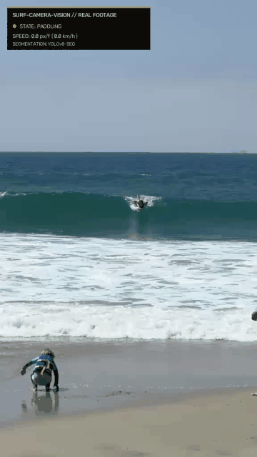
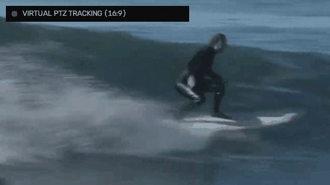
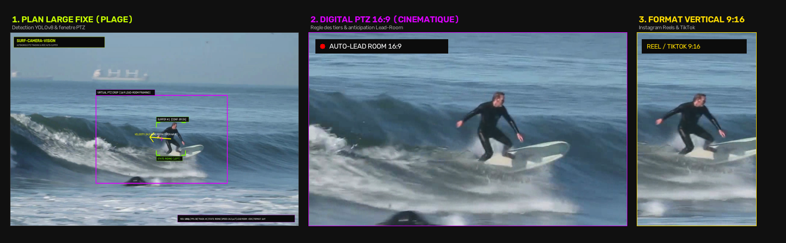
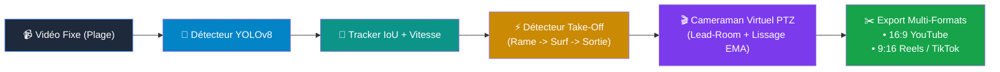

# 🏄 Surf-Camera-Vision : Autonomous Virtual PTZ (pan-tilt-zoom) 

[](https://www.python.org/downloads/)
[](https://pytorch.org/)
[](https://docs.ultralytics.com/)
[](https://opencv.org/)
[](https://streamlit.io/)
[](LICENSE)

> **Computer Vision & Cameraman Virtuel (Digital PTZ) : segmentation d'instance (surfeur & planche), détection automatique de take-off, suivi de trajectoire et recadrage cinématique fluide de sessions de surf.**

<div align="center">
  <h3>🎯 Détection & Segmentation d'Instance en Milieu Réel (iPhone 9:16)</h3>
  
  <p><em>Session à Huntington Beach, CA (c'est moi! 😎😎) : masques polygonaux surfeur et planche (YOLOv8-Seg), classification de posture (Paddling ➔ Take-Off ➔ Riding) et télémétrie de vitesse.</em></p>
</div>

---

## 📐 Modélisation & Formulation Algorithmique

Le pipeline repose sur trois composantes mathématiques simples pour le suivi et le cadrage autonome en milieu marin :

### 1. Détection du Take-Off (Classification de Posture & Cinématique)
La transition entre la phase de rame et le surf debout est caractérisée par une inversion géométrique de la boîte englobante ($w/h$) corrélée à une accélération locale :

$$\text{Rame (Paddling)} : \frac{w}{h} > 1.10 \quad\longrightarrow\quad \text{Take-Off (Riding)} : \frac{w}{h} \le 0.90 \quad \text{et} \quad \|\vec{v}\| \ge v_{\text{seuil}}$$

Un tampon circulaire conserve en continu 2 secondes de pré-roll afin de garantir la capture complète de la prise de vague dès les premiers coups de rame.

---

### 2. Cadrage Virtuel & Lead-Room (Règle des Tiers)
Pour reproduire le cadrage d'un cadreur professionnel et éviter de filmer l'écume morte derrière le surfeur, le centre de la caméra virtuelle est projeté en avant du mouvement selon le vecteur vitesse $\vec{v}$ :

$$c_x^{\text{cible}} = c_x^{\text{surfeur}} + \frac{v_x}{\|\vec{v}\|} \cdot (W_{\text{crop}} \times \lambda_{\text{lead}})$$

Le surfeur est ainsi naturellement maintenu sur le tiers arrière du cadre, réservant les deux tiers de l'espace visuel au déroulement de la vague.

<div align="center">
  <h3>🎬 Cameraman Virtuel PTZ (Exemple Secondaire : Plan Large ➔ Recadrage)</h3>
  
  <p><em>Simulation cinématique : suivi fluide avec rotule amortie (EMA) et anticipation d'ouverture de vague (Lead Room).</em></p>
</div>



---

### 3. Amorti Cinématique (Lissage Temporel Exponentiel)
Afin d'émuler l'inertie d'une rotule fluide de trépied et de filtrer le bruit haute fréquence des détections YOLO, les coordonnées et dimensions du cadrage $(c_x, c_y, w, h)$ sont filtrées par lissage exponentiel (EMA) :

$$C_t = (1 - \alpha) \cdot C_{t-1} + \alpha \cdot C_t^{\text{cible}} \quad \text{avec } \alpha \approx 0.10$$

Ce compromis élimine tout tremblement numérique tout en conservant la réactivité nécessaire lors des virages appuyés (*bottom turns*, *cutbacks*).

---

### 4. Échelle Métrique Conjointe & Latent VAE Prior (Surfeur + Planche)
Pour convertir avec précision les pixels de caméra monoroculaire en unités métriques réelles (km/h et mètres), le module `scale_estimator.py` implémente un **Variational Autoencoder (VAE)** conjoint :

$$q(z \mid \mathbf{x}) = \mathcal{N}(\boldsymbol{\mu}_z, \boldsymbol{\sigma}_z^2) \quad \text{avec } \mathbf{x} = [w_s, h_s, r_s, w_b, h_b, r_b]$$

Le décodeur reconstruit le ratio d'échelle métrique $\text{m/px}$ en combinant le prior physiologique du surfeur ($\approx 1.75\text{ m}$) et les dimensions rigides de la planche ($\approx 1.83\text{ m}$ / 6'0"). Ce prior probabiliste latent garantit une échelle stable même lorsque le surfeur fléchit les jambes ou que la planche est partiellement immergée sous l'écume.

---

### 5. Segmentation Morphologique du Rouleau & Hauteur de Vague
Le moteur `wave_analyzer.py` segmente en temps réel la masse d'eau en mouvement et le déferlement de la vague par analyse spectrale HSV (mousse blanche $V > 175, S < 75$) et gradients de luminance de Sobel ($\nabla_y I$) :

$$H_{\text{vague}} = (y_{\text{trough}} - y_{\text{crest}}) \cdot S_{\text{m/px}}$$

où $S_{\text{m/px}}$ représente le ratio d'échelle métrique (mètres par pixel) estimé par le prior VAE conjoint. Les vagues sont automatiquement quantifiées en mètres, en pieds et classées selon la terminologie officielle du surf (*Knee*, *Waist*, *Chest*, *Head High*, *Overhead*, *Double Overhead*).

---

## 🏗️ Architecture du Pipeline



---

## ⚡ Démarrage Rapide

### 1. Installation
```bash
git clone https://github.com/eliottrouvier/surf-camera-vision.git
cd surf-camera-vision
pip install -r requirements.txt
```

### 2. Démo en 1 Clic
```bash
python3 demo.py
```
*Télécharge automatiquement une séquence réelle 1080p, exécute le tracking et exporte les clips découpés en 16:9 et 9:16 dans `outputs/`.*

---

## 🖥️ Utilisation

### Application Web Interactive (Streamlit)
```bash
streamlit run app.py
```
Interface moderne pour déposer vos vidéos, ajuster interactivement le zoom, la Lead-Room et télécharger les clips découpés.

### Ligne de Commande (CLI Batch)
```bash
# Export cinématique 16:9 (YouTube)
python3 track_surf.py --input ma_session.mp4 --aspect 16:9 --output-dir outputs/

# Export vertical 9:16 (Instagram Reels / TikTok) + Vidéo Double Écran (Side-by-Side 1080p)
python3 track_surf.py --input ma_session.mp4 --aspect 9:16 --lead-room 0.35 --zoom-scale 4.0

# Tester directement sur la séquence iPhone réelle fournie :
python3 track_surf.py --input data/user_surf_iphone.mov --aspect 9:16
```

---

## 🧪 Tests Unitaires

```bash
pytest tests/ -v
```
Vérifie le respect des bordures (zéro bande noire), la transition de la machine à états et les équations de cadrage cinématique.

---

## 📂 Organisation du Code

```
surf-camera-vision/
├── app.py                     # Application Web Streamlit
├── demo.py                    # Démo 1-clic autonome
├── track_surf.py              # CLI batch
├── surf_camera/
│   ├── detector.py            # YOLOv8 (surfeur & planche)
│   ├── tracker.py             # Spatio-temporal tracker & vitesse
│   ├── state_machine.py       # Classification Rame -> Take-Off -> Surf
│   ├── cameraman.py           # Digital PTZ (Lead Room & lissage)
│   ├── scale_estimator.py     # JointScaleVAE & calibration métrique conjointe
│   ├── wave_analyzer.py       # Segmentation de la masse d'eau & hauteur crête/creux
│   ├── pipeline.py            # Moteur d'assemblage & encodage H.264
│   └── utils.py               # Badge minimaliste & HUD télémétrique
└── tests/                     # Suite de tests automatisés pytest
```

---

## 📄 Licence

Distribué sous licence **MIT**. Voir [`LICENSE`](LICENSE).
