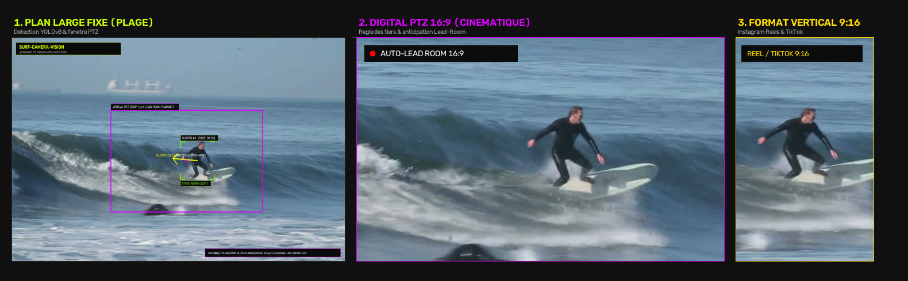
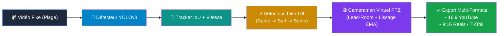

# 🏄 Surf-Camera-Vision : Autonomous Virtual PTZ & Biomechanical Lab (v2.0)

[](https://share.streamlit.io)
[](https://www.python.org/downloads/)
[](https://pytorch.org/)
[](https://docs.ultralytics.com/)
[](https://opencv.org/)
[](https://streamlit.io/)
[](LICENSE)

> **Computer Vision, Cameraman Virtuel (Digital PTZ) & Coach Biomécanique IA : segmentation d'instance (surfeur & planche), estimation de posture articulaire (17 keypoints YOLOv8-Pose), classification automatique des manœuvres (Bottom Turn, Roller, Tube) et rendu studio comparatif 1080p Biomechanical Lab.**

<div align="center">
  <h3>🎯 Détection & Segmentation d'Instance en Milieu Réel (iPhone 9:16)</h3>
  
  <p><em>Session réelle à Huntington Beach, CA (c'est moi 😎😎 — surfeur : 185 cm [6'1"], planche : 5'8" [1,73 m]) :<br>
  masques polygonaux surfeur & planche (YOLOv8-Seg) • classification de posture (Paddling ➔ Take-Off ➔ Riding) • télémétrie métrique en direct (km/h & vagues en m/ft).</em></p>
</div>

---

## ⚡ Démarrage 1-Clic Ultra-Simple

### Option A : En Ligne sur Internet (0 Installation)
Tu peux déployer ou tester directement l'application sur **Streamlit Community Cloud** en connectant ce repo GitHub en 1 clic. L'interface Web se lance sans aucun téléchargement requis.

### Option B : Sur ton Ordinateur en 1 Seul Double-Clic
Télécharge le projet (via `git clone` ou le bouton vert **Code ➔ Download ZIP**) et lance l'app immédiatement :

- **🍏 macOS :** Double-cliquez simplement sur **`launch_app.command`** dans le Finder.  
  *(Crée l'environnement virtuel, installe les dépendances et ouvre l'application dans votre navigateur automatiquement).*
- **🪟 Windows :** Double-cliquez sur **`launch_app.bat`**.
- **🐧 Linux / Terminal :** Exécutez `./start.sh`.

---

## ⚙️ Configuration & Unités Universelles

Tous les paramètres de base sont centralisés dans **[`config.yaml`](./config.yaml)** avec des valeurs par défaut élégamment calibrées. Vous pouvez les modifier directement dans le fichier ou via le bouton **💾 Sauvegarder** du volet latéral de l'application Web :

- **Surfeur (favorisé en centimètres) :** `185 cm` *(avec équivalent international 6'1")*.
- **Planche de surf (favorisé en pieds & pouces) :** `5'8"` *(avec équivalent métrique 1,73 m)*.
- **Taille de vague (double affichage simultané) :** exprimée en mètres ET en pieds *(ex: `1.65 m (5.4 ft) [Head High]`)*.
- **Vitesse maximale :** calculée en **`km/h`** pour chaque vague surfée avec affichage sur le badge flottant.
- **Cadrage PTZ :** ratio par défaut `9:16` (format vertical Instagram Reels / TikTok), zoom `4.0x`, lead-room `0.35`, amorti cinématique `0.10`.

---

## 📐 Modélisation & Formulation Algorithmique

Le pipeline repose sur des composantes mathématiques simples pour le suivi et le cadrage autonome en milieu marin :

### 1. Détection du Take-Off (Classification de Posture & Cinématique)
La transition entre la phase de rame et le surf debout est caractérisée par une inversion géométrique de la boîte englobante (rapport largeur / hauteur) corrélée à une accélération locale :

$$
\text{Rame (Paddling)} : \frac{w}{h} > 1.10 \quad \implies \quad \text{Take-Off (Riding)} : \frac{w}{h} \le 0.90 \quad \text{et} \quad \|\vec{v}\| \ge v_{\text{seuil}}
$$

Un tampon circulaire conserve en continu 2 secondes de pré-roll afin de garantir la capture complète de la prise de vague dès les premiers coups de rame.

---

### 2. Cadrage Virtuel & Lead-Room (Règle des Tiers)
Pour reproduire le cadrage d'un cadreur professionnel et éviter de filmer l'écume morte derrière le surfeur, le centre de la caméra virtuelle est projeté en avant du mouvement selon le vecteur vitesse instantané :

$$
c_x^{\text{cible}} = c_x^{\text{surfeur}} + \frac{v_x}{\|\vec{v}\|} \cdot (W_{\text{crop}} \times \lambda_{\text{lead}})
$$

Le surfeur est ainsi naturellement maintenu sur le tiers arrière du cadre, réservant les deux tiers de l'espace visuel au déroulement de la vague.

<div align="center">
  <h3>🎬 Cameraman Virtuel PTZ (Exemple Secondaire : Plan Large ➔ Recadrage)</h3>
  
  <p><em>Simulation cinématique : suivi fluide avec rotule amortie (EMA) et anticipation d'ouverture de vague (Lead Room).</em></p>
</div>



---

### 3. Amorti Cinématique (Lissage Temporel Exponentiel)
Afin d'émuler l'inertie d'une rotule fluide de trépied et de filtrer le bruit haute fréquence des détections YOLO, les coordonnées et dimensions du cadrage (position et taille de fenêtre) sont filtrées par lissage exponentiel (EMA) :

$$
C_t = (1 - \alpha) \cdot C_{t-1} + \alpha \cdot C_t^{\text{cible}} \quad \text{avec } \alpha \approx 0.10
$$

Ce compromis élimine tout tremblement numérique tout en conservant la réactivité nécessaire lors des virages appuyés (*bottom turns*, *cutbacks*).

---

### 4. Échelle Métrique Conjointe & Latent VAE Prior (Surfeur + Planche)
Pour convertir avec précision les pixels de caméra monoroculaire en unités métriques réelles (km/h et mètres), le module `scale_estimator.py` implémente un **Variational Autoencoder (VAE)** conjoint :

$$
q(z \mid \mathbf{x}) = \mathcal{N}(\mu_z, \sigma_z^2) \quad \text{avec } \mathbf{x} = [w_s, h_s, r_s, w_b, h_b, r_b]
$$

Le décodeur reconstruit le ratio d'échelle métrique en mètres par pixel en combinant la taille de référence du surfeur (**6'1" / 1,85 m**) et les dimensions rigides de la planche (**5'8" / 1,73 m** sur notre vidéo de session). Ce prior probabiliste latent garantit une échelle stable même lorsque le surfeur fléchit les jambes ou que la planche est temporairement immergée sous l'écume.

---

### 5. Segmentation Morphologique du Rouleau & Hauteur de Vague
Le moteur `wave_analyzer.py` segmente en temps réel la masse d'eau en mouvement et le déferlement de la vague par analyse spectrale HSV (mousse blanche à haute luminance) et gradients de luminance verticaux de Sobel :

$$
H_{\text{vague}} = (y_{\text{trough}} - y_{\text{crest}}) \cdot S
$$

où $S$ représente le ratio d'échelle métrique (mètres par pixel) estimé par le prior VAE conjoint. Les vagues sont automatiquement quantifiées en mètres, en pieds et classées selon la terminologie officielle du surf (*Knee*, *Waist*, *Chest*, *Head High*, *Overhead*, *Double Overhead*).

---

## 🚀 Nouveautés Surf AI v2 : Biomécanique & Classification des Manœuvres

La **v2.0** enrichit le système d'une analyse articulée fine pour transformer chaque vidéo en outil de perfectionnement technique :

### 1. Inférence Hybride à 2 Niveaux (Macro-Perception & Micro-Pose)
Pour conserver des performances ultra-rapides en temps réel, l'estimation de pose ne traite pas toute la frame 4K / 1080p :
- **Niveau 1 :** Détection et tracking global (surfeur debout sur la vague).
- **Niveau 2 :** Extraction d'un crop haute résolution centré ($288 \times 288$ px) envoyé à **YOLOv8-Pose** sur accélération Apple Silicon MPS (~3ms par inférence).
- **Re-projection :** Les 17 keypoints sont recalculés dans le repère mondial de la vidéo et sur le plan cadré.

### 2. Moteur Cinématique & Télémétrie Articulaire
- **Flexion des genoux ($\theta_{\text{knee}}$) :** Mesure angulaire de 0° à 180° calculée par produit scalaire $\mathbf{P}_{\text{hip}} - \mathbf{P}_{\text{knee}} - \mathbf{P}_{\text{ankle}}$.
- **Inclinaison du torse ($\theta_{\text{torso}}$) :** Orientation du vecteur hanches ➔ épaules par rapport à la verticale.
- **Taux de compression ($C_{\text{ratio}}$) :** Hauteur bassin-chevilles normalisée par la taille du surfeur.
- **Accélération centrifuge (G-Force) :** Taux de rotation angulaire corrélé à la vitesse instantanée.

### 3. Classification Automatique des Figures
- 🔥 **Bottom Turn :** Position en bas de vague ($y > 0.55$), inclinaison du torse $\ge 24^\circ$, flexion des genoux $< 125^\circ$.
- ⚡ **Roller / Snap :** Position sommitale crête ($y \le 0.35$), rotation brutale des épaules ($\Delta \phi \ge 15^\circ$) et redirection de vitesse.
- 🌊 **Tube / Barrel :** Hyper-flexion ($\theta_{\text{knee}} < 85^\circ$), compression $C_{\text{ratio}} < 0.48$ et position continue sous la lèvre.
- 🏄 **Carve / Cutback :** Prise de carre médiane fluide avec inclinaison prolongée.

### 4. Rendu Studio Split-Screen "Biomechanical Lab" (1080p)
Format side-by-side synchronisé :
- **Gauche :** Plan d'action réel avec squelette néon incrusté sur le surfeur et badge flottant de manœuvre.
- **Droite :** Studio sombre avec grille perspective, avatar vectoriel 3D luminescent centré, et jauges cinématiques en direct (flexion, inclinaison, G-force, vitesse km/h).

---

## 🏗️ Architecture du Pipeline



---

## ⚡ Démarrage Rapide

### 1. Installation
```bash
git clone https://github.com/eliottrouvier/surf-camera-vision.git
cd surf-camera-vision
pip install -r requirements.txt
```

### 2. Démo en 1 Clic
```bash
python3 demo.py
```
*Télécharge automatiquement une séquence réelle 1080p, exécute le tracking et exporte les clips découpés en 16:9 et 9:16 dans `outputs/`.*

---

## 🖥️ Utilisation

### Application Web Interactive (Streamlit)
```bash
streamlit run app.py
```
Interface moderne pour déposer vos vidéos, ajuster interactivement le zoom, la Lead-Room et télécharger les clips découpés.

### Ligne de Commande (CLI Batch)
```bash
# Utilise automatiquement tous les réglages par défaut de config.yaml :
python3 track_surf.py --input ma_session.mp4

# Personnalisation rapide (taille en cm, planche en ft/in, ratio 9:16) :
python3 track_surf.py --input data/user_surf_iphone.mov \
  --aspect 9:16 \
  --surfer-height-cm 185 \
  --board-length-ft-in "5'8\"" \
  --lead-room 0.35 \
  --output-dir outputs/
```

---

## 🧪 Tests Unitaires

```bash
pytest tests/ -v
```
Vérifie le respect des bordures (zéro bande noire), la transition de la machine à états, les équations de cadrage cinématique, la conversion d'unités, les angles articulaires 3 points, la classification des manœuvres et le studio biomécanique (**27 tests validés**).

---

## 📂 Organisation du Code

```
surf-camera-vision/
├── launch_app.command         # 🍏 Lanceur 1-clic macOS (double-clic Finder)
├── launch_app.bat             # 🪟 Lanceur 1-clic Windows (double-clic)
├── start.sh                   # 🐧 Lanceur terminal Linux / macOS
├── config.yaml                # ⚙️ Configuration centralisée & valeurs par défaut
├── app.py                     # Studio Web Streamlit v2.0 (Biomechanical Lab)
├── track_surf.py              # CLI batch avec support cm & ft/in
├── train_surf_yolo.py         # Script de fine-tuning local sur Apple Silicon (MPS)
├── demo.py                    # Démo 1-clic autonome
├── packages.txt               # Dépendances système Streamlit Cloud (ffmpeg, libgl1)
├── requirements.txt           # Dépendances Python
├── dataset_surf/              # Dataset préparé & augmenté (train/val + augmentations marines)
├── surf_camera/
│   ├── config.py              # Gestionnaire config.yaml & conversion d'unités
│   ├── detector.py            # YOLOv8 (surfeur & planche)
│   ├── tracker.py             # Spatio-temporal tracker & vitesse
│   ├── state_machine.py       # Classification Rame -> Take-Off -> Surf & consolidation
│   ├── cameraman.py           # Digital PTZ (Lead Room & lissage)
│   ├── pose_estimator.py      # Moteur d'estimation de pose 17 keypoints (YOLOv8-Pose)
│   ├── maneuver_classifier.py # Détecteur de figures (Bottom Turn, Roller, Tube, Carve)
│   ├── scale_estimator.py     # JointScaleVAE & calibration métrique conjointe
│   ├── wave_analyzer.py       # Segmentation de la masse d'eau & hauteur crête/creux
│   ├── dataset_extractor.py   # Extracteur de keyframes & data augmentations marines
│   ├── pipeline.py            # Moteur d'assemblage & studio double flux H.264
│   └── utils.py               # Badge HUD, squelette néon & studio Biomechanical Lab
└── tests/                     # Suite de tests automatisés pytest (27 tests)
```

---

## 📄 Licence

Distribué sous licence **MIT**. Voir [`LICENSE`](LICENSE).
