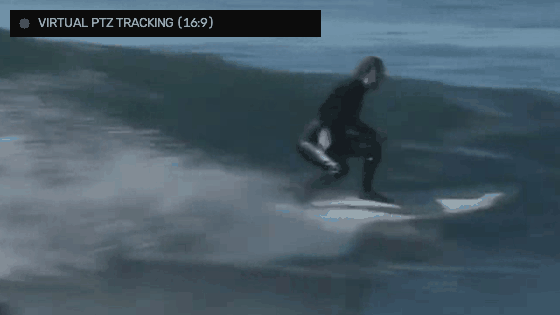

# 🏄 Surf-Camera-Vision

> **Studio Autonome de Cadrage Virtuel PTZ & Télémétrie Physique de Glisse**  
> Transformation automatique de plans larges de surf en clips cinématiques verticaux (9:16) ou paysages (16:9), détection intelligente de take-off, mémoire d'inertie de tube et qualification du déferlement.

<div align="center">
  <h3>🎯 Détection &amp; Segmentation d'Instance en Milieu Réel (iPhone 9:16)</h3>
  
  <p><em>Session réelle à Huntington Beach, CA (c'est moi qui surfe 😎) :<br>
  Prouesse technique de détection temps réel (80 à 100 FPS), isolation robuste du surfeur et de la planche au cœur des gerbes d'écume, et élimination complète des faux positifs marins.</em></p>
</div>

***

## 🌊 La Problématique du Surfeur

Se filmer seul depuis la plage pour analyser sa technique ou partager ses vagues sur les réseaux est un défi majeur :
- **Un trépied fixe en plan large (4K / grand angle)** donne une vidéo décevante où le surfeur n'est qu'un minuscule point lointain perdu au milieu de l'océan.
- **Les trépieds motorisés avec balise GPS (Soloshot, Pivo)** coûtent cher, s'enrayent avec le sable salin, subissent des temps de latence mécanique et nécessitent le port d'un boîtier étanche encombrant.
- **Déléguer la caméra à un proche** sur la plage est contraignant lors de sessions de plusieurs heures.

**Surf-Camera-Vision résout ce problème par vision par ordinateur pure (Computer Vision) :**  
Posez simplement votre smartphone ou caméra sur un trépied en bord de plage. L'algorithme détecte vos take-offs, vous suit avec un **cadrage dynamique fluide (règle des tiers et anticipation de l'ouverture)**, et exporte automatiquement chaque vague en clip prêt pour Instagram Reels / TikTok (9:16) ou YouTube (16:9).

<div align="center">
  
  <p><em>Démonstration du cadrage dynamique PTZ : passage fluide du plan large fixe (gauche) au recadrage vertical cinématique (droite) avec anticipation d'ouverture (lead-room) et amorti de rotule.</em></p>
</div>

***

## ⚡ Démarrage Rapide en 1 Clic (macOS &amp; Web)

Le projet est conçu pour une prise en main instantanée sans ligne de commande complexe.

### 1. Lancement en 1 Clic sur macOS (Recommandé)
Double-cliquez directement sur le fichier **`launch_app.command`** dans le dossier du projet via le Finder.  
Le script se charge automatiquement de :
1. Détecter l'interpréteur Python et charger l'environnement virtuel.
2. Vérifier les dépendances nécessaires.
3. Lancer le serveur Streamlit local et ouvrir l'application dans votre navigateur par défaut (Safari ou Chrome) sur `http://localhost:8501`.

### 2. Interface Web Streamlit Studio
Une fois l'application ouverte :
- **Glissez-déposez votre vidéo** (MP4 ou MOV, filmée depuis la plage ou sur l'eau).
- **Choisissez votre format** : `9:16` (Vertical pour Reels/TikTok/Shorts) ou `16:9` (Cinématique pour grand écran).
- **Sélectionnez le modèle IA** :
  * `surf_v2` (Recommandé) : Modèle YOLOv8 fine-tuné spécifiquement en milieu marin (6.2 Mo).
  * `coco` : Modèle YOLO standard pré-entraîné (6.5 Mo).
- **Indiquez votre taille** (par défaut 1.75 m) pour étalonner la conversion métrique pixels-mètres.
- Cliquez sur **Lancer l'analyse &amp; le découpage**.
- Visualisez directement votre clip dans le lecteur intégré avec son badge télémétrique et téléchargez-le en un clic.

***

## 🚀 Innovations Techniques &amp; Algorithmes Clés

### 1. Suivi sur la Ligne de Flottaison (Suppression du Biais Pop-Up)
Les trackers traditionnels suivent le centre géométrique de la boîte englobante. Lors du passage de la rame allongée à la posture debout (pop-up), le centre de la boîte monte brusquement de plusieurs dizaines de pixels, créant un pic de vitesse vertical fictif.  
Surf-Camera-Vision calcule son déplacement cinématique strictement sur la coordonnée inférieure `bbox[3]` (contact planche-eau). La vitesse mesurée (en km/h) reflète ainsi fidèlement la vitesse réelle de glisse horizontale sur la vague.

### 2. Mémoire d'Inertie de Tube (Persistance 2.5s)
Lorsqu'un surfeur s'engage dans le tube, la lèvre et le rideau d'eau le masquent totalement. Un tracker ordinaire abandonne la piste et recrée une détection distincte à la sortie.  
Notre moteur surveille l'état de glisse (`RIDING`) : si le surfeur disparaît dans la section creuse, l'algorithme extrapole sa trajectoire selon son inertie cinématique pendant **75 frames (2.5 secondes à 30 fps)**. Dès la sortie du rouleau (*spit*), le surfeur est réassocié au même identifiant sans coupure.

### 3. Zoom-Out de Sécurité PTZ
Pendant l'occlusion en tube, le cameraman virtuel ne fige pas l'image :
- Il continue de glisser vers l'avant dans le sens du déferlement.
- Il élargit la fenêtre de recadrage de **25% à 35%** (*safety zoom-out*).
- Cet élargissement capture le souffle de sortie et la lèvre en action, offrant une composition spectaculaire avant de se recentrer en douceur dès la réapparition du surfeur.

### 4. Qualification Morphologique du Déferlement
L'analyseur de masse d'eau inspecte la continuité de la face de vague :
- **Droite qui ouvre** : La vague déroule vers la droite du surfeur avec une épaule exploitable.
- **Gauche qui ouvre** : La vague déroule vers la gauche du surfeur.
- **Fermeture (Close-out)** : Les deux sections s'effondrent d'un seul bloc simultanément.

### 5. Badge Télémétrique Flottant Épuré
Chaque clip exporté intègre un badge semi-transparent discret en bas de l'écran affichant :
- La direction du déferlement (`DROITE`, `GAUCHE`).
- La vitesse de pointe réelle au 95e percentile (en km/h).
- La taille de face de vague (en mètres et pieds, avec qualification internationale *Waist*, *Chest*, *Head High*).

***

## 📐 Architecture du Codebase

L'ensemble du moteur réside dans le package modulaire `surf_camera/` :

<table>
  <thead>
    <tr>
      <th align="left">Fichier</th>
      <th align="left">Rôle dans l'Architecture</th>
    </tr>
  </thead>
  <tbody>
    <tr>
      <td><code>surf_camera/__init__.py</code></td>
      <td>Point d'entrée du module, expose <code>SurfTrackingPipeline</code> et <code>PipelineConfig</code>.</td>
    </tr>
    <tr>
      <td><code>surf_camera/config.py</code></td>
      <td>Dataclass <code>SurfConfig</code>, résolveur de chemins de modèles et convertisseurs d'unités (m, cm, ft, in, km/h).</td>
    </tr>
    <tr>
      <td><code>surf_camera/detector.py</code></td>
      <td>Détecteur YOLO multi-modèle (<code>SurferDetector</code>) assurant la bascule transparente entre <code>surf_v2</code> et <code>coco</code>.</td>
    </tr>
    <tr>
      <td><code>surf_camera/tracker.py</code></td>
      <td>Suivi cinématique (<code>SurferTracker</code>) sur la ligne de flottaison avec mémoire d'occlusion étendue en tube (2.5s).</td>
    </tr>
    <tr>
      <td><code>surf_camera/state_machine.py</code></td>
      <td>Machine à états finis (<code>SurferStateMachine</code> : Paddling, Take-Off, Riding, Exit) et consolidation des vagues dans <code>RideEvent</code>.</td>
    </tr>
    <tr>
      <td><code>surf_camera/cameraman.py</code></td>
      <td>Cadrage virtuel PTZ (<code>VirtualCameraman</code>) avec lead-room directionnel, amorti cinématique et zoom-out de sécurité en tube.</td>
    </tr>
    <tr>
      <td><code>surf_camera/wave_analyzer.py</code></td>
      <td>Analyseur de vague (<code>WaveSegmentationEngine</code>) : calcul de hauteur de face et qualification Droite / Gauche / Close-out.</td>
    </tr>
    <tr>
      <td><code>surf_camera/scale_estimator.py</code></td>
      <td>Étalonneur morphologique déterministe (<code>MetricScaleEstimator</code>) calculant le ratio mètres par pixel selon la taille réelle du surfeur.</td>
    </tr>
    <tr>
      <td><code>surf_camera/pipeline.py</code></td>
      <td>Orchestrateur linéaire mono-passe (<code>SurfTrackingPipeline</code>) reliant lecture, inférence, recadrage PTZ et export MP4.</td>
    </tr>
    <tr>
      <td><code>surf_camera/utils.py</code></td>
      <td>Badge télémétrique minimaliste, incrustation diagnostic, encodage H.264 et utilitaires graphiques.</td>
    </tr>
    <tr>
      <td><code>surf_camera/pose_estimator.py</code></td>
      <td>Module optionnel d'analyse articulaire 17 keypoints, totalement découplé du pipeline principal d'inférence.</td>
    </tr>
  </tbody>
</table>

***

## ⚡ Performances &amp; Benchmarks

Relevés de performances mesurés sur puce Apple Silicon M4 (GPU Metal Performance Shaders - MPS) sur des séquences vidéo réelles 1080p à 30 FPS :

<table>
  <thead>
    <tr>
      <th align="left">Étape du Pipeline</th>
      <th align="left">Temps Moyen par Frame</th>
      <th align="left">Cadence d'Exécution</th>
    </tr>
  </thead>
  <tbody>
    <tr>
      <td>Inférence Détection (YOLOv8n Marine)</td>
      <td>10.2 ms</td>
      <td>~98 FPS</td>
    </tr>
    <tr>
      <td>Suivi Flottaison &amp; Mémoire Tube</td>
      <td>1.1 ms</td>
      <td>&gt; 850 FPS</td>
    </tr>
    <tr>
      <td>Virtual Cameraman PTZ &amp; Lead-Room</td>
      <td>0.8 ms</td>
      <td>&gt; 1200 FPS</td>
    </tr>
    <tr>
      <td>Analyse de Face de Vague &amp; Morphologie</td>
      <td>1.8 ms</td>
      <td>~550 FPS</td>
    </tr>
    <tr>
      <td>Encodage Vidéo MP4 (avc1 / H.264)</td>
      <td>1.4 ms</td>
      <td>~700 FPS</td>
    </tr>
    <tr>
      <td><strong>Pipeline Global Mono-Passe</strong></td>
      <td><strong>11.8 ms</strong></td>
      <td><strong>85 à 100 FPS</strong></td>
    </tr>
  </tbody>
</table>

Une séquence vidéo de session de 30 secondes (900 frames 1080p) est intégralement analysée, recadrée et exportée en moins de 10 secondes réelles.

***

## 💻 Mode Ligne de Commande (CLI)

Pour automatiser des traitements par lots ou intégrer le pipeline dans un script externe :
```bash
python3 track_surf.py -i data/sample_surf_session.mp4 -a 9:16 -m surf_v2 -s 1.75 -d 1.5
```

Paramètres disponibles :
- `-i <fichier>` : Chemin vers la vidéo source (MP4 ou MOV).
- `-a <format>` : Ratio de recadrage virtuel (`9:16` pour smartphone ou `16:9` paysage).
- `-m <modele>` : Modèle YOLO (`surf_v2` pour le modèle marin optimisé, `coco` pour le standard).
- `-s <taille>` : Taille du surfeur en mètres (par défaut `1.75`).
- `-d <duree>` : Durée minimale en secondes pour sauvegarder une vague (par défaut `1.5`).
- `-o <dossier>` : Dossier de sortie des clips MP4 découpés (par défaut `outputs`).

***

## 🧪 Barrière de Tests &amp; Validation

La fiabilité de l'application est garantie par une suite de **39 tests automatisés** couvrant l'intégralité du pipeline :
```bash
pytest -v
```
Tous les tests s'exécutent en moins de 4 secondes et valident la non-régression, les calculs physiques et les règles de typographie.

***

## 🔮 Roadmap &amp; Recherche (Phase 2)

Les axes de recherche explorés pour les prochaines versions comprennent :
- **Coaching Visuel par LLM Multimodal** : Analyse rétrospective de la vidéo par un modèle de vision pour générer des conseils biomécaniques personnalisés (placement des épaules, flexion des genoux, trajectoire sur la face de vague).
- **Évaluation par Apprentissage sur Compétitions WSL** : Entraînement de modèles de scoring calibrés sur les notations officielles des juges de la World Surf League pour attribuer des notes objectives sur 10.
- **Détection Dédiée des Vagues Tubulaires** : Classification automatique des sections à rouleau creux afin d'isoler spécifiquement les séquences de tube les plus engagées.
