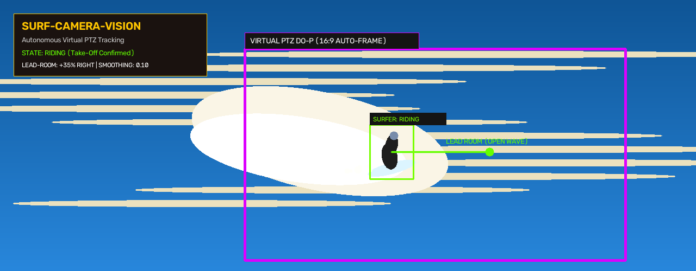
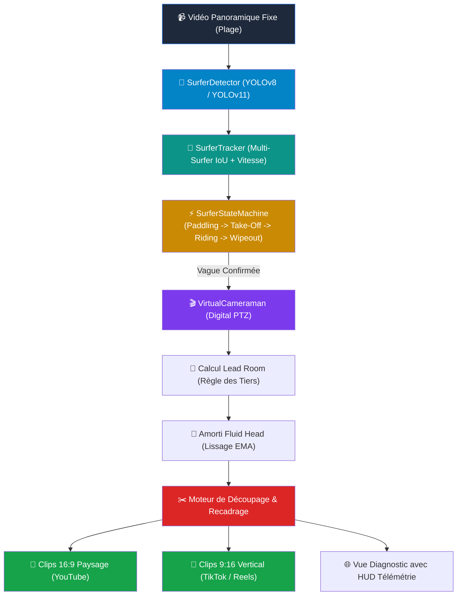

# 🏄 Surf-Camera-Vision : Autonomous Virtual PTZ Cameraman for Surfers

[](https://www.python.org/downloads/)
[](https://pytorch.org/)
[](https://docs.ultralytics.com/)
[](https://opencv.org/)
[](https://streamlit.io/)
[](LICENSE)

> **Un cameraman virtuel intelligent (Digital PTZ) par Computer Vision pour filmer et découper automatiquement vos vagues de surf depuis la plage.**



---

## 🌊 La Problématique du Surfeur

Quand on surfe seul, se filmer depuis la plage est un casse-tête :
- **Un trépied fixe avec plan large (4K / grand angle)** donne une vidéo décevante où le surfeur n'est qu'un minuscule point perdu au milieu de l'océan.
- **Les trépieds motorisés avec balise GPS (type Soloshot / Pivo)** coûtent des centaines d'euros, tombent en panne dans le sable, subissent des lags mécaniques et nécessitent de porter un tracker étanche lourd.
- **Déléguer à un ami** sur la plage est rarement faisable sur des sessions de 2 heures.

**`Surf-Camera-Vision` résout ce problème par pur traitement d'image et Computer Vision :**
Posez simplement votre iPhone ou caméra fixe sur un trépied en plan large 4K/1080p sur la plage. L'algorithme analyse la vidéo, détecte automatiquement vos take-offs, vous suit à travers les vagues avec un **cadrage cinématique fluide (Lead Room & règle des tiers)**, et découpe chaque vague en clip individuel prêt pour YouTube (16:9) ou Instagram Reels / TikTok (9:16).


---

## 🚀 Fonctionnalités Clés

- 🎯 **Détection Multi-Échelle Spécialisée :** Détecteur YOLO optimisé pour repérer les surfeurs et planches dans des conditions marines extrêmes (écume, reflets du soleil, vagues en déferlement).
- 🏄‍♂️ **Machine à États Take-Off & Ride Automatisée :** Détecte la transition cinématique critique :
  $$\text{Rame Allongé (Paddling)} \longrightarrow \text{Pop-Up (Take-Off)} \longrightarrow \text{Glisse (Riding)} \longrightarrow \text{Wipeout / Sortie}$$
  en analysant le ratio d'aspect de la silhouette ($w/h$) et le vecteur de vitesse instantanée.
- 🎬 **Cameraman Virtuel Cinématique (Digital PTZ) :**
  - **Lead Room & Règle des Tiers :** Anticipe le sens du déferlement (vague en droite ou en gauche) pour décentrer harmonieusement le surfeur et placer la face ouverte de la vague dans le champ.
  - **Amorti "Fluid Head" :** Lissage temporel dynamique (filtre amortisseur exponentiel) qui élimine tout tremblement numérique pour un rendu de travelling professionnel.
  - **Multi-Formats :** Export automatique en **16:9 Paysage** (HD/4K) ou **9:16 Vertical** pour les réseaux sociaux.


- ✂️ **Découpage Automatique des Vagues (Ride Auto-Cut) :** Chaque vague surfée est automatiquement découpée avec un buffer de pré-roll (2s de rame avant le take-off) et post-roll.
- 💻 **Application Web Interactive (Streamlit) :** Interface moderne pour déposer vos vidéos, ajuster le zoom et télécharger vos clips découpés.
- ⚡ **CLI Scriptable :** Mode batch en ligne de commande pour traiter des gigaoctets de sessions en arrière-plan.

---

## 🏗️ Architecture du Pipeline



---

## 📐 Principes Mathématiques & Cinématiques

### 1. Détection du Take-Off par Rupture d'Aspect & Cinématique
Un surfeur en train de ramer présente une boîte englobante horizontale allongée :
$$\text{Aspect Ratio} = \frac{\text{Largeur}}{\text{Hauteur}} > 1.15$$
Au moment précis du take-off (pop-up), la géométrie subit une transition brutale :
$$\frac{\text{Largeur}}{\text{Hauteur}} \le 0.90 \quad \text{et} \quad \|\vec{v}\| = \sqrt{v_x^2 + v_y^2} \ge v_{\text{takeoff}}$$
Cette double condition déclenche l'événement `RideEvent` avec un tampon circulaire de pré-roll ($2\,\text{s}$) pour capturer le départ complet.

### 2. Composition "Lead Room" (Règle des Tiers)
Pour éviter un centrage plat d'amateur, la caméra virtuelle applique un décalage proportionnel à la direction du vecteur vitesse normalisé :
$$c_x^{\text{cible}} = c_x^{\text{surfeur}} + \frac{v_x}{\|\vec{v}\|} \cdot (W_{\text{crop}} \times \lambda_{\text{lead}})$$
- Si le surfeur part en droite ($v_x > 0$), la caméra se décale vers la droite : le surfeur est positionné sur le tiers gauche de l'écran, laissant les deux tiers ouverts sur le déroulement de la vague.
- Si le surfeur part en gauche ($v_x < 0$), le surfeur est positionné sur le tiers droit.

### 3. Lissage par Amortisseur Dynamique (Fluid-Head Emulation)
Pour émuler l'inertie mécanique d'une tête de trépied à fluide et supprimer tout vacillement de boîte de détection, les coordonnées du centre $(c_x, c_y)$ et les dimensions du cadrage $(w, h)$ sont filtrées à chaque frame $t$ :
$$C_t = (1 - \alpha) \cdot C_{t-1} + \alpha \cdot C_t^{\text{cible}}$$
où $\alpha \in [0.08, 0.15]$ assure un suivi réactif sans à-coups.

---

## ⚡ Installation & Démarrage Rapide

### 1. Cloner le dépôt
```bash
git clone https://github.com/eliottrouvier/surf-camera-vision.git
cd surf-camera-vision
```

### 2. Installer les dépendances
```bash
pip install -r requirements.txt
```

### 3. Lancer la Démonstration en 1 Clic
```bash
python demo.py
```
*Le script génère automatiquement une séquence vidéo de surf haute définition, exécute le tracking, et exporte instantanément les clips découpés en 16:9 et 9:16 dans `outputs/`.*

---

## 🖥️ Utilisation

### Mode 1 : Application Web Interactive (Streamlit)
Lancez l'interface graphique dans votre navigateur :
```bash
streamlit run app.py
```
- Glissez-déposez votre vidéo de session ou chargez la session démo.
- Ajustez les curseurs de **Lead Room**, de **Zoom** et d'**Amorti**.
- Prévisualisez les clips découpés, inspectez la timeline des rides et téléchargez vos vidéos.

### Mode 2 : Ligne de Commande (CLI)
Pour traiter des sessions complètes en batch :
```bash
# Export standard 16:9 avec télémétrie
python track_surf.py --input ma_session.mp4 --output-dir outputs/ --aspect 16:9

# Export optimisé pour Instagram Reels / TikTok (9:16 vertical)
python track_surf.py --input ma_session.mp4 --aspect 9:16 --lead-room 0.40 --zoom-scale 4.0
```

---

## 🧪 Tests Unitaires & Intégration

Le projet inclut une suite complète de tests vérifiant la robustesse mathématique des algorithmes :
```bash
pytest tests/ -v
```
Tous les tests valident :
- L'invariance de cadrage et le calcul de Lead Room (droite / gauche).
- Le bridage strict aux bordures de l'image (zéro bande noire accidentelle).
- La machine à états (transitions Rame $\to$ Take-off $\to$ Ride $\to$ Wipeout).
- L'exécution end-to-end du pipeline.

---

## 📂 Structure du Dépôt

```
surf-camera-vision/
├── app.py                     # Application Web Interactive Streamlit
├── demo.py                    # Script de démonstration autonome en 1 clic
├── track_surf.py              # Interface CLI modulaire
├── requirements.txt           # Dépendances du projet
├── surf_camera/
│   ├── __init__.py            # Exports du package
│   ├── detector.py            # Détecteur YOLOv8/11 (surfeur & planche)
│   ├── tracker.py             # Tracker multi-surfeurs & cinématique
│   ├── state_machine.py       # Machine à états & détecteur de vagues surfées
│   ├── cameraman.py           # Cameraman virtuel (Lead Room & lissage PTZ)
│   ├── pipeline.py            # Moteur complet de traitement & découpage
│   └── utils.py               # HUD télémétrique, vidéo I/O & générateur démo
├── tests/
│   ├── test_cameraman.py      # Tests du cadrage cinématique et lissage
│   ├── test_state_machine.py  # Tests des transitions de take-off
│   └── test_pipeline.py       # Test d'intégration complet
└── outputs/                   # Dossier de sauvegarde des clips (.gitkeep)
```

---

## 📄 Licence

Distribué sous licence **MIT**. Voir [`LICENSE`](LICENSE) pour plus de détails.
