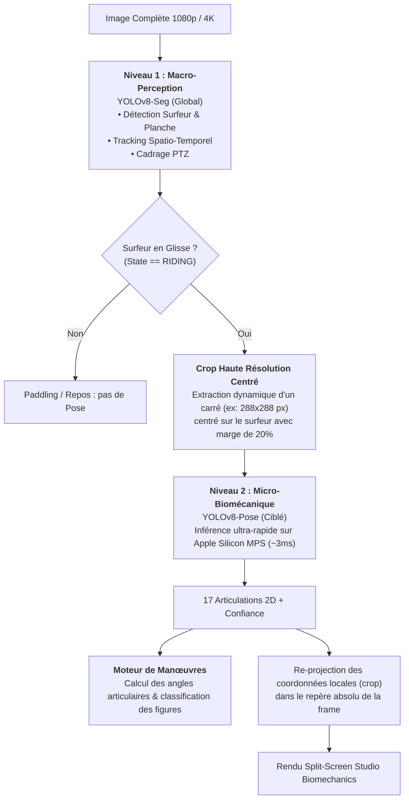
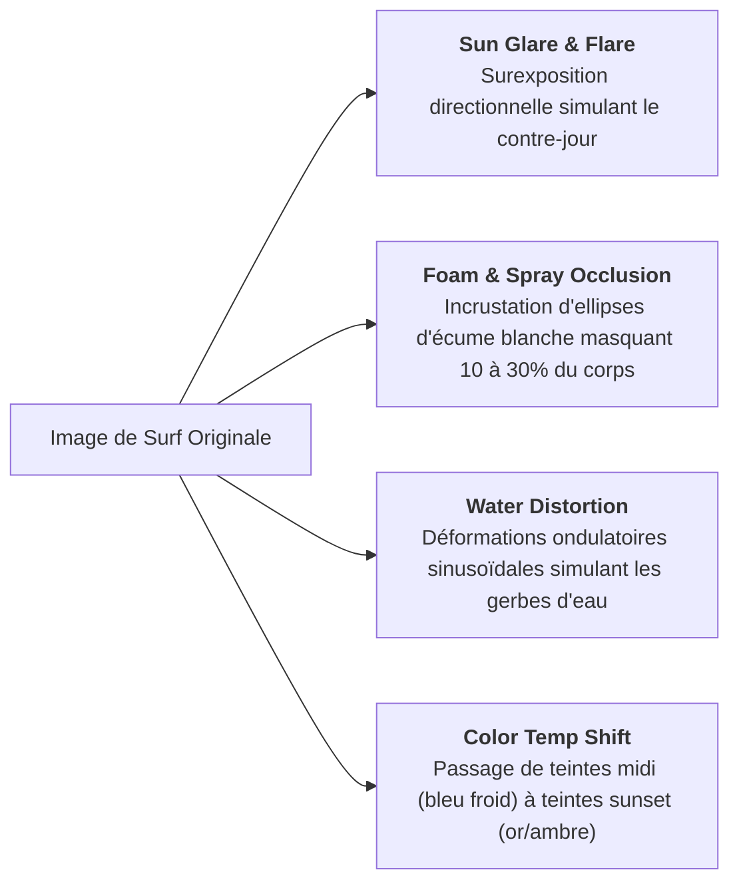
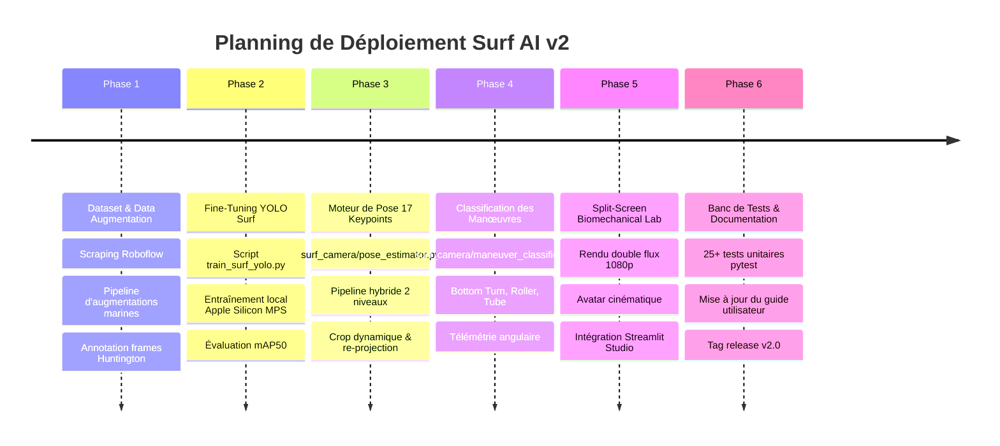

# 🚀 Plan d'Action Surf AI v2 : Fine-Tuning Spécifique & Analyse Biomécanique des Manœuvres

> **Document de Cadrage Stratégique & Spécifications Techniques**  
> *Projet : `surf-camera-vision` — Version 2.0*  
> *Auteur : Antigravity & Eliott Rouvier*  
> *Date : Novembre 2026*

---

## 📑 Sommaire

1. [Vision Globale & Objectifs v2](#1-vision-globale--objectifs-v2)
2. [Architecture du Pipeline Hybride à 2 Niveaux](#2-architecture-du-pipeline-hybride-à-2-niveaux)
3. [Stratégie Datasets Roboflow & Data Augmentation Marine](#3-stratégie-datasets-roboflow--data-augmentation-marine)
4. [Protocole de Fine-Tuning Local sur Apple Silicon (PyTorch MPS)](#4-protocole-de-fine-tuning-local-sur-apple-silicon-pytorch-mps)
5. [Moteur Géométrique de Détection des Manœuvres (Maths & Formules)](#5-moteur-géométrique-de-détection-des-manœuvres-maths--formules)
   - 5.1. [Extraction des 17 Keypoints & Angles Clés](#51-extraction-des-17-keypoints--angles-clés)
   - 5.2. [Modélisation du Bottom Turn](#52-modélisation-du-bottom-turn)
   - 5.3. [Modélisation du Roller / Snap](#53-modélisation-du-roller--snap)
   - 5.4. [Modélisation du Tube / Barrel](#54-modélisation-du-tube--barrel)
6. [Rendu Studio Split-Screen Biomechanical Lab](#6-rendu-studio-split-screen-biomechanical-lab)
7. [Feuille de Route d'Implémentation Étape par Étape](#7-feuille-de-route-dimplémentation-étape-par-étape)

---

## 1. Vision Globale & Objectifs v2

La version actuelle (v0.2.1) résout brillamment le **suivi global**, le **cadrage PTZ**, l'**estimation de vitesse (km/h)** et la **hauteur de vague (m/ft)**. 

La **v2.0** a pour vocation de transformer le système en un **véritable coach biomécanique et analyste de performance sportive** :
1. **Surmonter les limites de COCO en mer :** Fine-tuner YOLOv8 sur des surfeurs dans des conditions réelles extrêmes (reflets solaires, contre-jour couchant, combinaison noire mouillée, clapot et gerbes d'eau).
2. **Comprendre la posture articulée (17 keypoints) :** Suivre la cinématique des genoux, du bassin et des épaules.
3. **Classifier automatiquement les manœuvres clés :**
   - 🔥 **Bottom Turn :** compression et inclinaison en bas de vague.
   - ⚡ **Roller / Snap :** transfert de masse et rotation violente en haut de vague.
   - 🌊 **Tube / Barrel :** hyper-flexion et pénétration sous la lèvre déferlante.
4. **Offrir un rendu visuel Split-Screen "Biomechanical Lab" :** Vidéo réelle filmée d'un côté et avatar articulaire stylisé de l'autre avec télémétrie angulaire en direct.

---

## 2. Architecture du Pipeline Hybride à 2 Niveaux

Exécuter un modèle d'estimation de pose sur une vidéo complète 4K ou 1080p est prohibitif en temps de calcul. Le pipeline hybride à 2 niveaux résout ce défi avec élégance :



### Avantages Majeurs :
- **Ultra-rapide :** L'inférence de pose ne traite que $288 \times 288$ pixels au lieu de $1920 \times 1080$ (gain de calcul supérieur à **$15\times$**).
- **Zéro fausse alerte à la rame :** L'analyse biomécanique ne s'active que lorsque le surfeur est confirmé debout sur sa planche.

---

## 3. Stratégie Datasets Roboflow & Data Augmentation Marine

### 3.1. Datasets Cibles Roboflow
Pour créer un dataset d'entraînement hautement représentatif, nous agrégerons 3 sources complémentaires issues de **Roboflow Universe** :
1. **Surf / Surfer Detection Dataset :** Détection de surfeurs debout et couchés sous différents angles de vue plage.
2. **Action Sports Wetsuit & Board :** Détection fine des combinaisons néoprènes et des rails de planches dans l'écume.
3. **Huntington Beach Custom Set :** Extraction et labellisation de ~100 frames clés issues directement de ta propre vidéo réelle.

### 3.2. Pipeline de Data Augmentation Marine Spécifique
Les surfeurs subissent des conditions optiques introuvables sur la terre ferme. Le pipeline d'augmentation appliquera :



---

## 4. Protocole de Fine-Tuning Local sur Apple Silicon (PyTorch MPS)

### Configuration Technique
L'entraînement tournera directement en local sur ton Mac via le backend **Apple Silicon MPS** (`Metal Performance Shaders`) :

```python
# Script type : train_surf_yolo.py
from ultralytics import YOLO

# 1. Charger le modèle pré-entraîné
model = YOLO("yolov8n-seg.pt")

# 2. Entraînement avec transfert d'apprentissage
results = model.train(
    data="data/surf_dataset.yaml",
    epochs=60,
    imgsz=640,
    batch=16,
    device="mps",               # Accélération matérielle Apple Silicon
    freeze=10,                  # Gèle les premières couches du backbone
    optimizer="AdamW",
    lr0=0.001,
    lrf=0.01,
    dropout=0.10,
    cos_lr=True,                # Décroissance cosinusale du learning rate
    save_period=10,
    project="runs/surf_finetuning",
    name="yolov8n_surf_v2",
)
```

---

## 5. Moteur Géométrique de Détection des Manœuvres (Maths & Formules)

### 5.1. Extraction des 17 Keypoints & Angles Clés

Le squelette COCO fournit 17 points :
$$\mathbf{P}_i = (x_i, y_i, c_i) \quad \text{pour } i \in [0, 16]$$
- **Haut du corps :** Épaules ($i=5, 6$), Coudes ($i=7, 8$), Poignets ($i=9, 10$).
- **Bassin & Tronc :** Hanches ($i=11, 12$).
- **Membres inférieurs :** Genoux ($i=13, 14$), Chevilles ($i=15, 16$).

```
           (0) Nez
         (1)   (2) Yeux
        (3)     (4) Oreilles
          \     /
       (5)-------(6) Épaules
        |    |    |
       (7)  (c)  (8) Coudes
        |         |
       (9)       (10) Poignets
        |         |
      (11)-------(12) Hanches (Bassin)
        |         |
       (13)     (14) Genoux
        |         |
       (15)     (16) Chevilles
```

#### A) Angle Articulaire des Genoux ($\theta_{\text{knee}}$)
Mesuré pour la jambe avant et la jambe arrière via le produit scalaire :
$$\vec{u} = \mathbf{P}_{\text{hip}} - \mathbf{P}_{\text{knee}}, \quad \vec{v} = \mathbf{P}_{\text{ankle}} - \mathbf{P}_{\text{knee}}$$

$$\theta_{\text{knee}} = \arccos \left( \frac{\vec{u} \cdot \vec{v}}{\|\vec{u}\| \|\vec{v}\|} \right) \times \frac{180}{\pi}$$
- $\theta \approx 170^\circ$ : jambe complètement tendue.
- $\theta < 90^\circ$ : flexion marquée (virage ou tube).

#### B) Taux de Compression Corporelle ($C_{\text{ratio}}$)
Rapport entre la hauteur instantanée du bassin et la hauteur de référence du surfeur debout :
$$C_{\text{ratio}} = \frac{y_{\text{ankle}} - y_{\text{hip}}}{h_{\text{debout\_ref}}}$$

#### C) Inclinaison du Torse ($\theta_{\text{torso}}$)
Angle du vecteur passant par le milieu des hanches et le milieu des épaules par rapport à la normale verticale :
$$\vec{T} = \frac{\mathbf{P}_5 + \mathbf{P}_6}{2} - \frac{\mathbf{P}_{11} + \mathbf{P}_{12}}{2}$$
$$\theta_{\text{torso}} = \arctan2(T_x, -T_y) \times \frac{180}{\pi}$$

---

### 5.2. Modélisation du Bottom Turn

Le **Bottom Turn** est la fondation de toute manœuvre de surf : le surfeur descend en bas de vague et s'incline puissamment sur la carre pour remonter vers la lèvre.

```
       Crête de la vague
       ~~~~~~~~~~~~~~~~~~~~~~~~
      /
     /
    /  <---- Remontée vers la lèvre
   /
  (SURFEUR INCLINÉ 35°+)
  ============================= Creux de vague (Trough)
```

**Conditions Algorithmiques :**
1. **Position sur la vague :** Le surfeur est situé dans le tiers inférieur de la vague :
   $$y_{\text{surfeur}} \ge y_{\text{crest}} + 0.65 \times (y_{\text{trough}} - y_{\text{crest}})$$
2. **Inclinaison prononcée :** $|\theta_{\text{torso}}| \ge 30^\circ$ orientée vers l'intérieur de la vague.
3. **Compression modérée à forte :** $C_{\text{ratio}} \in [0.40, 0.70]$.
4. **Courbure de trajectoire ascendante :** Le vecteur accélération vertical pointe vers le haut :
   $$a_y = \frac{d^2 y}{dt^2} < -1.5\text{ px/f}^2$$

---

### 5.3. Modélisation du Roller / Snap

Le **Roller** (ou *Snap*) s'exécute au sommet de la vague : frapper la lèvre déferlante avec un pivotement brutal du haut du corps.

**Conditions Algorithmiques :**
1. **Position sommitale :** Le surfeur atteint la crête active :
   $$y_{\text{surfeur}} \le y_{\text{crest}} + 0.25 \times (y_{\text{trough}} - y_{\text{crest}})$$
2. **Rotation rapide des épaules :** Vitesse de variation angulaire de la ligne inter-épaules :
   $$\omega_{\text{shoulders}} = \left| \frac{\Delta \phi_{\text{shoulders}}}{\Delta t} \right| \ge 25^\circ / \text{frame}$$
3. **Inversion ou cassure du vecteur vitesse horizontale :** $v_x$ change brutalement de sens ou chute de plus de 50% en moins de 5 frames.

---

### 5.4. Modélisation du Tube / Barrel

La manœuvre reine du surf : le surfeur est totalement recouvert par la lèvre de la vague.

**Conditions Algorithmiques :**
1. **Hyper-compression prolongée :**
   $$C_{\text{ratio}} < 0.40 \quad \text{et} \quad \theta_{\text{knee}} < 75^\circ$$
2. **Position sous le rideau d'eau :** La tête du surfeur est située sous la ligne de crête de la vague :
   $$y_{\text{head}} > y_{\text{crest}}$$
3. **Occlusion partielle continue :** Les keypoints du haut du corps (épaules/tête) ont une confiance de détection qui chute sous $0.40$ (car masqués par le rideau d'eau) pendant au moins $0.8\text{ s}$ alors que le tracking persiste.

---

## 6. Rendu Studio Split-Screen Biomechanical Lab

Le rendu vidéo comparatif sera structuré en format **1920x1080** haute fidélité :

```
+------------------------------------+------------------------------------+
| 🎬 PLAN RECADRÉ (ACTION RÉELLE)    | 🔬 BIOMECHANICAL LAB (AVATAR 3D)   |
|                                    |                                    |
| [Surfeur réel filmé]               |   Squelette Vectoriel Luminescent  |
|   + Squelette néon incrusté        |   + Jauges Cinématiques en Direct :|
|   + Badge flottant de manœuvre :   |     • Angle Genoux : 82° [FLEXION] |
|     🔥 BOTTOM TURN (G-Force 3.1)   |     • Inclinaison Torse : 38°      |
|                                    |     • Vitesse : 28.5 KM/H          |
| [ 28.5 KM/H • WAVE 1.6M • 4.5S ]   |     • Statut : ENGAGEMENT CARVE    |
+------------------------------------+------------------------------------+
```

---

## 7. Feuille de Route d'Implémentation Étape par Étape



---

## 🎯 Prochaine Action

Ce plan d'action constitue le **schéma directeur complet** de la v2.0. Dès que tu es prêt, il nous suffira de dérouler la **Phase 1** (préparation du dataset et des augmentations marines) ! 🌊🏄‍♂️
